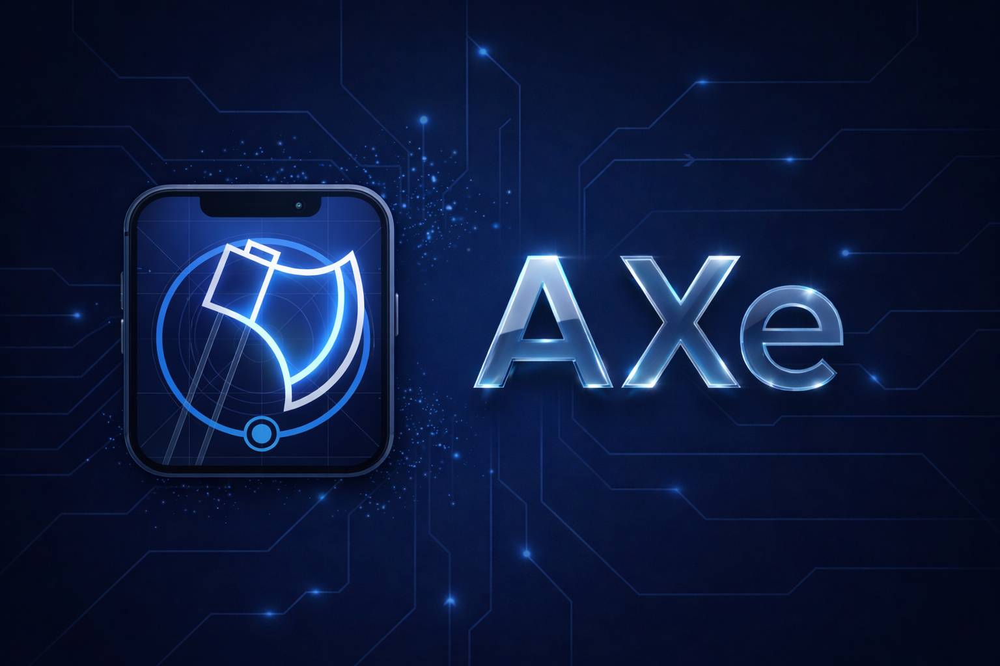

AXe is a comprehensive CLI tool for interacting with iOS Simulators using Apple's HID (Human Interface Device) functionality.

[](https://github.com/cameroncooke/AXe/actions/workflows/release.yml)
[](https://opensource.org/licenses/MIT)

## Install

```bash
brew tap cameroncooke/axe
brew install axe
```

Or install in one command:

```bash
brew install cameroncooke/axe/axe
```

Verify the CLI:

```bash
axe --help
axe list-simulators
```

## Xcode compatibility

AXe supports Xcode 26 and Xcode 27. Xcode 27 simulator automation uses Device Hub; Simulator.app is not required.

Release artifacts are built once with the Xcode version selected by the release environment and run unchanged with either supported Xcode selected. Compatibility was validated with Xcode 26.5 (build `17F42`) and iOS 26.5 (`23F77`), and with Xcode 27 Beta 3 (build `27A5218g`) and iOS 27 (`24A5380g`).

AXe builds IDB from the immutable fork revision configured in `scripts/build.sh`, based on a verified upstream IDB revision. The build applies the tracked Duo foundation patch and checks its complete source hashes. Unexpected checkout changes stop the build without discarding them. The current Duo integration supports local `AXE_BUILD_ARCHS=arm64` builds; universal release verification is still open.

## E2E development

`make e2e` rebuilds the local IDB XCFrameworks, builds AXe, and runs the simulator tests with the Xcode selected by `DEVELOPER_DIR` or `xcode-select`. XcodeGen is required to generate the IDB projects. When Xcode 27 is selected, the runner starts Device Hub, chooses an available iOS 27 iPhone 17 Pro, and boots it with `simctl`.

To validate a release payload unchanged under another supported Xcode, first build the test bundle with that Xcode, then run `AXE_BIN_PATH=/path/to/release/axe ./test-runner.sh --tests-only`. The supplied executable must retain its packaged frameworks beside it.

For local Duo work, use `AXE_BUILD_ARCHS=arm64`. After the final SwiftPM clean, run `AXE_BUILD_ARCHS=arm64 scripts/build.sh debug-helper` to build and sign `cadisplay-context` beside the actual debug executable. Selected input requires this simulator helper; AXe does not search other runtime paths.

## Basic usage

```bash
# Find a booted simulator UDID
axe list-simulators
export UDID=<UDID>

# Inspect the current UI
axe describe-ui --udid "$UDID"

# Interact with the simulator
axe tap --label "Continue" --udid "$UDID"
axe type 'Hello world' --udid "$UDID"
axe screenshot --output ./screen.png --udid "$UDID"
```

## Simulator shutdown

Use `axe shutdown --udid <UUID>` to shut down exactly one simulator through the public `simctl` command. Names and the `booted` and `all` aliases are rejected. This command is simulator lifecycle control, not a guest lock or power-button action. It does not select a display or accept agent/batch options.

Success prints JSON with `source: "simctl"`, `udid`, `initialState`, `finalState: "Shutdown"` and `outcome`. `shutdownCompleted` requires a fresh state read after the one shutdown request. `alreadyShutdown` means the initial read found that state, with no shutdown request. The command has a shared 60-second budget for child commands and state observation. A failure or interruption does not undo a shutdown that has started; inspect the simulator state before another request. Success records the observed state, not a guarantee against a later boot by another client.

```bash
axe shutdown --udid "$UDID"
```

## Agent mode (experimental)

Add `--agent` to `describe-ui`, `tap`, `type`, `swipe` or `drag` for provider-free stateful control. Commands without the flag retain raw accessibility output and logical coordinate semantics. This mode is separate from `axe agent <goal>` and does not need a model or API key.

```bash
axe describe-ui --agent --udid "$UDID" --expected-pid "$APP_PID"
# Use the returned snapshot ID and element ref.
axe tap --agent --udid "$UDID" --expected-pid "$APP_PID" \
  --snapshot-id "$SNAPSHOT_ID" --ref "$REF"
axe type 'Hello' --agent --udid "$UDID" --expected-pid "$APP_PID" \
  --snapshot-id "$SNAPSHOT_ID" --ref "$FOCUSED_FIELD_REF"
axe swipe --agent --udid "$UDID" --expected-pid "$APP_PID" \
  --snapshot-id "$SNAPSHOT_ID" --ref "$SCROLL_REF" --direction up --distance 0.5
axe drag --agent --udid "$UDID" --expected-pid "$APP_PID" \
  --snapshot-id "$SNAPSHOT_ID" --ref "$REF" --end-x "$END_X" --end-y "$END_Y"
```

Capture discovers the measured active display unless an explicit selected pair is supplied. A positive current app PID is required. Compact RS/1-style JSON includes bounded `ref|action|role|label|value|id` rows, snapshot identity, context, cache status and action receipts. Use the capture paging options in `describe-ui --help` for omitted rows. `--since-screen-hash <hash>` still reads the current UI before reporting it unchanged. Cache reuse also checks a separate exact native fingerprint. The compact RS/1 `screenHash` uses normalized data; a matching hash alone does not prove unchanged raw UI.

Agent captures include `keyboard` evidence from the selected app's existing accessibility read, including unchanged and replacement captures. `state: "likelyVisible"` means visible Button IDs or labels match keyboard-key signals; `"unknown"` means no supported evidence was found, not that the keyboard is hidden. `source: "accessibility-key-signals"`, `scope: "selected-application"` and the four `signals` fields (`idChromeCount`, `globeSeen`, `letterKeyCount`, `chromeKeyCount`) show the basis. Counts use distinct matching IDs, labels and Latin letters. This heuristic adds no native query, does not prove keyboard focus and does not change typing checks.

References belong to one immutable snapshot and expire with the broker cache. Reference and coordinate actions require `--snapshot-id`; a ref alone is not a stable identifier. The runtime reads current context and accessibility data before input. A changed screen or boot, app, display, hinge, rotation or geometry invalidates old state. Refresh and choose the new ref; AXe does not silently reuse old coordinates. After an action, use its replacement capture or read a new snapshot. Cache loss and uncertain input require a fresh observation; input is never replayed automatically.

Agent `drag` starts at the fresh native centre of an existing `targets` or `scroll` reference. Supply `--snapshot-id`, `--ref`, `--expected-pid`, `--end-x` and `--end-y`; endpoints use decimal logical points, not screen fractions. The endpoint can leave the target frame but must stay inside the current selected display. Native point and tree reads must prove the start belongs to that target; choose the innermost scroll area when needed. Defaults remain 0.6-second movement, 60 steps and 0.05-second holds at each end. Duration is finite in (0,10], steps are 1...1000, each pre/post delay is 0...10 and total requested delay including holds is at most 20 seconds. Start coordinates, explicit selectors, AX preparation and batch steps are rejected. This does not expose new pad or slider references, or prove which control receives the endpoint. Stale or uncertain actions are never replayed. Use a matched CLI and broker; an older broker cannot decode the new drag action kind. Recorded inner-landscape reference drags, rejections and fold release/fresh tap passed. A later restoration rotation failed and remains recorded.

Typing keeps the existing US keyboard mapping and 256-byte limit. First tap and inspect the field; it must already be focused. Ref swipes use bounded current element geometry; `up` moves the finger up. Coordinate tap/swipe forms remain available with an agent snapshot, but do not prove an AX recipient. Other commands keep their existing interfaces and do not yet accept `--agent`. The existing native input and touch-release checks remain authoritative.

Keep agent captures within 4096 nodes and depth 64. The same `--row-offset` and `--row-limit` values (`rowOffset` and `rowLimit` in JSON) apply separately to the `targets`, `scroll` and `text` sections, with at most 64 rows per section. Agent typing limits its focused-field read to 512 nodes, depth 32 and 1 MiB of field output; its shared eight-second admission deadline remains unchanged. For nested scrolling, select the innermost scroll area that receives the gesture.

Visible controls without a unique native ID or label remain in the capture with their action marked unavailable. AXe offers `typeText` only for a currently focused native `TextField` with a unique exact ID; otherwise it offers `tap` when a unique native ID or label can resolve the field.

Agent `tap` also accepts `--label-contains <text>` for a case-sensitive literal substring or `--label-regex <pattern>` for Foundation `NSRegularExpression` syntax. Regex searches the native label; use `^` and `$` to anchor it. Groups and alternation such as `^(Save|Done)$` are supported. Matching is case-sensitive by default; Foundation inline options apply. Use exactly one of `--id`, `--label`, `--value`, `--label-contains`, `--label-regex`, `--ref` or a coordinate pair. An explicit selector can use the exact `--element-type` filter.

Use one optional `--frame 'minX=12.5,maxY=500.25'` with any explicit selector. Keys are `minX`, `maxX`, `minY` and `maxY`; values are finite non-negative logical UI points, including decimals. Omitted edges use the current screen bounds. The complete native element frame must fit the resulting positive rectangle within the current screen. Relative screen fractions, repeated keys, refs and coordinate targets are rejected. These three new options require `--agent` and apply only to `tap`.

```bash
axe tap --agent --udid "$UDID" --expected-pid "$APP_PID" \
  --label-contains 'Save' --element-type Button --frame 'minY=100.5,maxY=500.25'
axe tap --agent --udid "$UDID" --expected-pid "$APP_PID" \
  --label-regex '^(Save|Done)$' --element-type Button
```

The new queries allow 512 UTF-8 bytes, with regex patterns limited to 128 bytes and frame specifications to 256 bytes. Each candidate ID/label/value is limited to 4096 bytes; total candidate text is limited to 256 KiB under the existing 4096-node tree limit. Selection shares a 100 ms budget, with cooperative Foundation progress cancellation for regex matching. Pattern compilation has a byte cap and invalid-pattern rejection; Foundation does not expose compilation cancellation. A bound failure, no match or more than one match sends no input. Narrow the query instead of retrying unchanged. AXe resolves the fresh native tree, requires a unique exact native ID or label, then repeats the existing context, native-screen and target checks before input. A geometric match never authorizes cached-coordinate input. An older broker rejects a new selector payload instead of ignoring its filters.

## Selected Duo input

Ordinary `tap`, `touch`, `swipe` and `drag` without mode flags use the measured active display on the verified iPhone Duo profile. Coordinates remain logical UI points. Tap keeps legacy selector matching, styles and wait/poll options. Swipe and drag keep their existing event factories, movement duration, swipe delta and drag steps/holds. Their pre/post delays run on the host; normal text output remains. AXe checks boot, panel, hinge, orientation and geometry before input. These pose checks do not add an app/PID or UI-layout guard. Duo paths above 100,000 movement steps reject before event allocation; `drag --steps` retains its existing 1...1,000 limit. Other devices keep their existing routes. Ordinary Duo typing and [batches](#ordinary-duo-batches) use owned input as described below.

Ordinary Duo `touch -x <X> -y <Y> --down` starts one contact if none is held; another `--down` moves that contact. `--up` ends it at the point supplied to that command, without adding a move first. `--down --up` keeps the default 0.1-second hold; `--delay 0...10` sets that hold, and zero adds no delay. The broker keeps a successful down after the command exits and releases it after 60 seconds without an accepted touch request. Folding, rotation or context loss invalidates the stream and releases its input on the original connection. An up with no owned contact sends zero HID events; its internal outcome is `noOwnedContact`. It cannot release selected-token input. Read the UI again before a new contact after a change; do not replay uncertain input. Explicit selected retained touch still requires its receipt token and keeps its existing end-at-last-held-point behavior and 30-second idle limit. Standalone touch state does not transfer to a batch. Native callers must follow the [owned-input API contract](docs/duo-owned-input-api.md).

The local Duo candidate adds explicit display selection to `describe-ui`, `tap`, `slider`, `touch`, `swipe`, `drag`, `gesture`, `type`, `key`, `key-sequence`, `key-combo` and `button home`/`button side-button`. Pass `--input-mode selected --screen-id <ID> --screen-uuid <UUID>`. Use the display ID and UUID from a fresh device display read; do not assume that the primary display is active. Selected AX operations also require the current frontmost app PID through `--expected-pid`. No selected failure falls back to legacy input.

```bash
axe describe-ui --udid "$UDID" --input-mode selected \
  --screen-id "$SCREEN_ID" --screen-uuid "$SCREEN_UUID" --expected-pid "$APP_PID"
axe list-simulators --displays --udid "$UDID"
axe tap --id <identifier> --udid "$UDID" --input-mode selected \
  --screen-id "$SCREEN_ID" --screen-uuid "$SCREEN_UUID" --expected-pid "$APP_PID"
axe hinge read --udid "$UDID"
axe hinge set 90 --udid "$UDID" --expected-boot <boot-identity-from-read>
```

`hinge set` also accepts the exact names `closed` (0 degrees), `tabletop` (90 degrees) and `open` (180 degrees). For example, use `axe hinge set tabletop --udid "$UDID" --expected-boot <boot-identity-from-read>`. Names are case-sensitive. Numeric angles from 0 through 180, including fractions, remain supported. Each name uses the same native request and measured mechanical completion as its numeric angle, with the same options and JSON output. A name does not select a screen or request readiness observation. Use both `--wait-for-screen-id` and `--wait-for-screen-uuid` for separate active-screen readiness observation, then read the UI before input.

Use `axe rotate left|right --udid <UDID> --screen-id <ID> --screen-uuid <UUID> --expected-boot <BOOT_ID>` to turn the Duo. Read the boot and active screen pair first. This device-wide action uses the common input lock and rejects held touches. It sends one request, observes two matching selected-screen positions, and checks that the position remains after the connection closes. `--timeout` sets the observation budget (0.5...15 seconds, default 8); native reads have separate bounds. The verified Duo profile supports all four inner positions and skips upside-down portrait on the outer screen. Read the UI again before input. App layout readiness is not guaranteed. Do not replay a failed or uncertain request. An uncertain send holds the input lock and saves a recovery record. This command is separate from the two-finger `gesture rotate` and is not a batch step.

Selected gestures include `pinch`, `double-tap`, `rotate`, `two-finger-tap`, `two-finger-hold` and standalone `two-finger-swipe`. Read `axe gesture --help` for their explicit geometry and timing. Input uses the selected screen's current logical coordinates. A fold or rotation invalidates old context; read the UI again before the next action. Hinge mechanical completion alone does not prove that the destination screen is ready.

For `two-finger-swipe`, give first start `-x/-y`, second start `--x2/--y2`, and both endpoints `--end-x/--end-y/--end-x2/--end-y2`. Both straight paths use one `--duration` (default 0.6 seconds) and maximum `--delta` spacing (default 5 logical points); either finger may stay still. Coincident logical contact positions, including between samples, reject before input; spatial crossings at different times remain allowed. The existing selected gesture limits and cleanup apply. Batch and agent mode reject this new gesture. See the [two-finger path contract](docs/duo-two-finger-paths.md) for bounds, native API and recorded verification. Inner-landscape paths and fold release/fresh tap passed.

The four edge presets accept `--edge-inset <points>` to change only the start distance from the named edge. The value must be finite and positive and leave an inward path. The opposite endpoint stays 20 logical points from its edge; default start inset 20, duration 0.3 seconds and delta 50 remain unchanged. For example, `swipe-from-left-edge --edge-inset 1` on a 951-point-wide display moves from x=1 to x=931. This option is available in legacy and selected commands and their batch steps; scroll and complete multi-touch gestures reject it. Selected paths use fresh display bounds. With an explicit inset, legacy input also requires the remaining path span to be at least the effective delta (50 by default); choose a smaller explicit delta for a shorter path. Selected input retains its safe single-step handling for short paths. This changes geometry only: it does not select a Back action, guarantee navigation, retry input or provide a fallback.

Selected `describe-ui --point X,Y` reads one element at oriented logical display coordinates. It requires the selected screen and current `--expected-pid`. The foreground app before and after the read, and the point result itself, must match that PID. Foreign or hosted-process results are rejected. This read sends no input and does not create a retained tap target.

Ordinary Duo `type` keeps literal, `--file` and `--stdin` loading, US key mapping and plain output. It sends the existing event sequence through one measured owned session, with startup readiness, continuous context checks, signal cancellation and owned key release. The command remains stateless and adds no PID/focus guard or selected text limit. Input can be partial on failure; never replay it. Other-device typing and optional agent behavior are unchanged.

Selected keyboard input also requires `--expected-pid <PID> --focus-id <exact-field-ID>`. The field must already be a focused, enabled, visible `TextField`; AXe does not focus it implicitly. Focus and context are checked before each key down. Key-up cleanup bypasses the focus check. Selected literal/file/stdin text is limited to 256 UTF-8 bytes using the existing US keyboard mapping. Each complete sequence is limited to 1024 events and 20 seconds of requested delay, with a shared eight-second admission budget. This does not provide an atomic OS keyboard-recipient guarantee. A failure can follow partial input; do not replay it automatically.

Selected slider control requires exactly one of `--id <ID>` or `--label <Label>`, plus `--endpoint minimum|maximum`. Labels match exactly and case-sensitively after trimming whitespace and newlines from both the query and native label; substring matching is not supported. Label selection can match a native Slider without an ID. Duplicate selector matches reject before optional `--element-type <Type>` filtering. The type filter is exact and case-sensitive, with no type-name trimming; empty or whitespace-only types reject. Native Slider role, expected PID, selected context, finite positive raw frame and value-domain checks remain required. Each owned-handle read, including the read before each semantic action and the final read, must match the root target itself; a matching child cannot replace it. A mismatch stops without fallback. Percentage `--value` and non-default wait/poll options remain unsupported; ID selection and legacy behavior are unchanged. Explicit selected retained touch operations use the receipt's token through `--contact-token`; read `axe touch --help` for complete and retained forms.

`list-simulators --displays --udid <UDID>` reports the measured integrated display catalogue, active panel, native size, scale and orientation for one booted simulator. It validates host identities and geometry against the device display read. The existing top-level fields are retained, with `bootIdentity` matched before/after discovery and `readInterval` containing `startedUptime` and `finishedUptime` in host monotonic seconds. These times bound the full discovery read; they are not frame timestamps or times to compare across machines. The result is an observation, not a lease or admission token. Selected input and capture still perform fresh checks. No new option is required, and default legacy capture is unchanged.

The selected-display path also recognises the exact iPad mini (A17 Pro) simulator profile (model `iPad16,2`, profile version `405`) as a rigid device with one integrated display when the measured catalogue and supported display-response schema match. This does not add hinge support or infer support for other iPad profiles. Display identity, geometry, rotation and boot checks still apply; default legacy commands are unchanged.

Ordinary selected `tap --id`, `tap --label` and `tap --value` accept optional `--element-type <Type>`, for example `--element-type Button` when that type appears in a fresh description. The filter is exact and case-sensitive, with no aliases or type-name trimming; empty or whitespace-only types reject. AXe applies it before uniqueness checks and again to the final selected target before input. For a Button hit through a proved StaticText descendant, the filter applies to the Button target, not the child. The current screen pair, expected PID and hit checks still apply. Coordinates and `--semantic-press` reject this option and polling. Selected requests use wire 27; old wire 26 requests reject. Tap routes on other devices are unchanged.

Ordinary selected ID/label/value taps accept `--wait-timeout <seconds>` greater than zero through 30 and `--poll-interval <seconds>` from 0.05 through 30 (default 0.25). Without a positive wait, only the default interval is valid. AXe retries only an absent match, under the original screen, hinge, rotation, boot and input lease. Duplicate matches, a wrong PID, acquisition errors, cancellation or changed device state stop before input. A match proceeds through the existing final target validation and one tap; final validation or input failure is not retried. The receipt records attempts, elapsed time and outcome. Put polling inside a selected batch tap step, for example `--step 'tap --id ready --expected-pid <PID> --wait-timeout 5'`. Batch-level polling remains rejected. A closed client connection cancels an active wait; input already sent is not undone, and this does not add whole-batch signal handling. A wait of zero keeps the immediate path.

Ordinary selected coordinate or ID/label/value taps accept explicit `--tap-style physical`, `--tap-style simulator` or `--tap-style automatic`. Omitted style and explicit `physical` keep the existing guarded touch path. Explicit `simulator` uses the real `tapAt` down/up sequence with no inserted hold. Explicit `automatic` uses that simulator sequence for coordinates. For selectors, it uses the existing `AccessibilityElement.isSwitchLikeControl` rule on the resolved target: physical for switch/toggle-like controls, simulator otherwise. The style choice is checked again on the fresh validated target before the first down; a changed choice rejects before input. This does not add legacy descendant/sibling redirection or retry another style after failure. Selector taps retain exact ID/label/value/type, current/final target and expected PID checks; coordinates have fresh selected bounds but no PID or AX target guard. Pre/post delays, context checks, owned release and cleanup remain in effect. Put the style inside a selected batch tap step, for example `--step 'tap --id <ID> --tap-style automatic --expected-pid <PID>'`; the same builder and guards apply. Non-default batch-level styles (`physical` or `simulator`) and non-default batch-level wait/poll options remain rejected. Explicit batch-level `automatic` is accepted as the existing default but does not change selected step style; a step with no style keeps the physical 0.1-second hold. `--semantic-press` rejects every explicit style. This is not full switch support or exact legacy timing parity. Verify the app effect separately; there is no semantic/legacy fallback or automatic replay.

Selected `tap --value <text>` uses the legacy scalar text conversion for AXValue: String first, then Int, Double and Bool converted to text. Missing, null, array and object values do not match. Both the query and scalar text trim surrounding whitespace/newlines, then compare case-sensitively; query text is not parsed as a number. For example, `true` differs from `TRUE`, and query `1.0` does not equal scalar text `1`. Empty or whitespace-only queries reject. Optional exact `--element-type` filters before strict uniqueness; selected matching does not prefer an actionable duplicate. The value must still match at the current and final guarded target checks. Keep the measured pair and expected PID, and verify the app effect separately. Values cannot be combined with coordinates, another selector or `--semantic-press`; there is no fallback.

Selected selector taps remain HID taps. They do not perform semantic AXPress when a hit cannot be proved. For one exact native `CheckBox`, `tap --semantic-press --id <ID>` explicitly sends one AXPress with the selected options and `--expected-pid`. This route rejects coordinates, labels, values, delays and every explicit tap style. It has no HID or mouse fallback. It is restricted to the inspected host AccessibilityPlatformTranslation image UUID; other images are rejected. A native reply does not prove the application effect, and an uncertain send must not be replayed.

Full keyboard, switch, media selection, batch and agent coverage remain incomplete; see the [implementation checklist](docs/duo-implementation-checklist.md). Commands without selected options retain their legacy route, except ordinary Duo `tap`, `touch`, `swipe`, `drag`, `type` and `batch` as described here. Selected options inside a legacy batch step still reject before legacy conversion; selected batches use batch-level selection.

## Selected Home button

Selected `button home` is available standalone or in a selected batch:

```bash
axe button home --udid "$UDID" --input-mode selected \
  --screen-id "$SCREEN_ID" --screen-uuid "$SCREEN_UUID" --expected-boot "$BOOT_ID"
```

Use the pair from a fresh active-display read. The screen pair guards the current context; Home acts on the whole device, not one display or app. Optional `--expected-boot` requires an exact match before the input connection opens. With no `--duration`, AXe sends down/up with no requested hold. An explicit duration must be finite, greater than zero and at most 10 seconds; fractional values such as `0.2` retain their meaning.

The JSON response can include `home` execution and cleanup evidence: phase, planned/sent counts, release/drain flags, interruption and any cleanup release records. It is absent when no execution evidence exists. These fields describe the owned transport; they are not an OS held-button inventory or proof that Home is visible. The final pose check is unchanged and can fail after Home has acted. Preserve the result and inspect the device separately; never replay a failed or uncertain request automatically.

Selected batches use the same Home request and guards. A selected Home step in a legacy batch rejects before legacy conversion. The legacy Home route is unchanged; selected side-button is described below.

## Selected side button

Use `axe button side-button --udid <UDID> --input-mode selected --screen-id <ID> --screen-uuid <UUID>` with a fresh active-panel pair. Optional `--expected-boot <BOOT_ID>` must match exactly before the input connection opens. The side button acts on the whole device; the screen pair guards admission, not button routing to a display or app. Omitted `--duration` sends down/up with no requested hold. An explicit duration must be finite, greater than zero and at most 10 seconds, including fractions such as `0.2`.

When execution evidence is available, response `button` identifies `kind: "side-button"` and contains `execution` phase, planned/sent counts, release/drain flags, interruption and cleanup records. It uses the same owned transport and evidence mapping as Home; Home keeps its existing `home` response. These records do not prove lock, wake, power, security state or an OS held-button inventory. The final context check remains strict and can fail after the button acts. Preserve a failed or uncertain result; do not replay it or send another button as a fallback. Inspect the visible effect separately.

Selected batches accept `--step 'button side-button --duration 0.2'` through the same request and guards. Completion requires the matching side-button kind and clean typed execution/release evidence. A failure stops later steps. Selected button options in a legacy batch still reject; legacy button routes are unchanged. Other buttons besides Home and side-button remain unsupported in selected mode.

## Ordinary Duo batches

The local source candidate routes ordinary no-flag `batch` through one measured Duo display, native session and common input lease for the whole ordered run, including host waits. It preserves the existing command list, selectors, tap styles, cache/poll settings, type chunks and normal text output. Points stay logical and are transformed once. Other devices keep their existing batch route.

A changed pose/context, native failure or cancellation stops later input without replay or a replacement session. `--continue-on-error` permits pre-input step errors only while the same session remains valid; input from an earlier step stays owned. Batch completion or failure closes remaining input, including a final down. No contact transfers to a standalone command. Step `type --stdin` observes cancellation/context while waiting without an EOF deadline and keeps the existing line-join behavior. Initial batch `--stdin` still reads the step list before input ownership. SIGINT/SIGTERM cancel and await the owned operation; SIGKILL cleanup is not guaranteed.

Build and native acceptance remain pending. Use matched AXe/native artifacts and verify real app effects before acceptance. See the [ordinary Duo batch contract](docs/duo-batch-owned-input.md) for native API, modifier, stdin and orphan-UP limits. This route adds no app/PID, focus or UI-layout guard.

## Selected batches

Set the UDID, input mode and display pair at batch level. Do not repeat or override them in a step:

```bash
axe batch --udid "$UDID" --input-mode selected \
  --screen-id "$SCREEN_ID" --screen-uuid "$SCREEN_UUID" \
  --step "tap --id $FIELD_ID --expected-pid $APP_PID" \
  --step "type 'Hello' --expected-pid $APP_PID --focus-id $FIELD_ID"
```

Selected batches support coordinate or ID/label/value `tap`, `slider` endpoints, `swipe`, `drag`, existing `gesture` forms except `two-finger-swipe`, complete `touch --down --up`, literal/file/stdin `type`, `key`, `key-sequence`, `key-combo` and `button home`/`button side-button`. ID/label/value tap steps accept `--element-type` through the same request builder and final target checks as standalone selected tap. Each selector tap needs its current `--expected-pid`; it accepts `--ax-preparation automation-session|existing-bridge`, with `automation-session` as the default. Each keyboard step needs `--expected-pid` and `--focus-id` for an already focused, enabled, visible TextField; keyboard checks use the existing bridge. An earlier tap does not waive the later focus check.

Selected batch `type --stdin` reads the process standard input once at that ordered step, before sending its keyboard request. Supply the step list with batch `--step` or `--file`, then pipe the text to AXe and close the pipe. The text must contain 1–256 UTF-8 bytes and use the existing US keyboard mapping; bytes and newlines are not trimmed or truncated. The synchronous read waits for EOF, has no deadline and cannot observe task cancellation while blocked. AXe checks task cancellation again after the read and before send. The normal current PID, focus and per-key checks still apply. Invalid or empty input stops later steps; earlier effects remain and input is not replayed. Batch-level `--stdin` consumes the same stream as the step list first, so a nested `type --stdin` sees EOF and rejects empty text. A second stdin text step also sees EOF after the first successful read; there is no separate text stream.

A selected `drag` step accepts `--start-x`, `--start-y`, `--end-x`, `--end-y`, `--duration`, `--steps`, `--pre-delay` and `--post-delay`, with the same validation and defaults as standalone selected drag (0.6-second movement and 60 steps). Coordinates are oriented logical display points. The owner checks the complete path against fresh selected bounds before input. This coordinate route does not accept selectors or `--expected-pid` and does not prove which app receives the drag. Legacy batch drag remains unsupported.

A selected `slider` step requires exactly one `--id` or `--label`, `--endpoint minimum|maximum` and positive `--expected-pid`. It inherits the batch screen pair and accepts `--ax-preparation automation-session|existing-bridge` (default `automation-session`). It uses native semantic endpoint control with zero HID events. A clean `endpointObserved` receipt completes the step after value readback; `alreadyAtEndpoint` completes without a new action. Neither outcome is a touch-release receipt or proof of an app callback. Optional `--element-type` uses the same builder and fresh native checks as standalone selected slider. Filtered completion also requires matching bounded native type evidence in the recorded samples and actions. Label steps use the same trimmed, case-sensitive matching and duplicate-before-type checks as standalone selected slider, including targets without an ID. Percentage `--value` and non-default wait/poll options are not supported. Legacy batch slider remains unsupported.

A selected `button home` step inherits the batch screen pair and uses the existing Home request on selected wire 27. Optional per-step `--expected-boot` must match exactly; optional `--duration` follows the standalone rule above, including positive fractions through 10 seconds and no requested hold when omitted. For example, use `--step "button home --expected-boot $BOOT_ID --duration 0.2"`. Home acts on the whole device; the active pair guards admission, not display-specific button routing. Batch completion requires matching typed Home execution and close evidence, two sent events, release and drain. It does not prove visible Home or an OS held-button inventory. A context failure can follow the Home effect; retain that failed receipt and do not replay it.

Selected `sleep <seconds>` waits on the host with no input lease or broker request. It accepts every finite non-negative Double duration, including zero, with no total cap. AXe measures monotonic elapsed time and uses bounded cancellable waits; this is not a readiness or exact timing guarantee. The JSON step receipt has a `hostWait` object with `requestedSeconds`, `elapsedSeconds`, `outcome` and an error when present; request ID and broker response are absent. A completed wait has status `completed`; interruption or wait-owner failure has `waitInterrupted` or `waitFailed` and stops later steps. SIGINT/SIGTERM handling applies only during the wait, cancels and awaits the owned wait task, then restores prior signal dispositions. This is not whole-batch signal handling or an atomic signal-boundary guarantee. Output failure also stops the batch. The next input step uses its normal fresh context/target/focus guards; sleep does not preserve or prove device state, reserve the device or inspect other processes' held input.

Each input step uses the guarded selected owner with fresh context and target or focus reads. No legacy HID session or batch AX cache is used. Stdout contains one JSON line per attempted step, with its index, command, request ID, status and full broker response when available. Input status is `completed`, `rejectedBeforeSend`, `failedResponse` or `outcomeUnknown`. Host wait statuses are described above. For HID steps, completion describes input transport, not the app effect. Slider completion uses its semantic endpoint receipt as described above. Any step or receipt-output failure stops later steps. Earlier steps are not undone, and uncertain input is not replayed. Steps are parsed in order; this is not all-or-nothing validation.

Selected batch does not yet support buttons other than Home and side-button, retained touch/token chaining, `tap --semantic-press` or other commands. These steps reject explicitly. `--continue-on-error` and non-default legacy cache, chunk, batch-level tap-style or batch-level polling settings also reject; per-step ordinary tap supports `--tap-style` values `physical`, `simulator` and `automatic`. Explicit batch-level `--tap-style automatic` has the same effect as omission: it does not set the selected step style. A tap step without its own style keeps the physical 0.1-second hold. Other default legacy settings do not enable those features in selected mode. Batch `--file` and `--stdin` still read the step list.

The selected common lease covers each operation, not the whole batch. Other input can occur between steps. A foreground change, fold or rotation requires fresh state; the batch does not choose another display or infer a new PID. Ordinary Duo batch ownership is described [above](#ordinary-duo-batches).

## Selected PNG screenshots

Use the paired display ID and UUID from a fresh `list-simulators --displays` read:

```bash
axe screenshot --udid "$UDID" --screen-id "$SCREEN_ID" \
  --screen-uuid "$SCREEN_UUID" --output ./selected.png
# Optional: reject a different boot, using the identity from hinge read
axe screenshot --udid "$UDID" --screen-id "$SCREEN_ID" \
  --screen-uuid "$SCREEN_UUID" --expected-boot "$BOOT_ID" --output ./selected-boot.png
```

This PNG route accepts only the measured active panel. Both selection options are required; it does not use `--input-mode` or `--expected-pid`. It rejects a changed context or invalid selection without choosing another display or using legacy capture. The signed `cadisplay-context` helper must be beside the AXe executable.

Selected capture does not replace an existing output file. On success, stdout contains a JSON receipt with `source: "appleSimctlSelectedPNG"`, the output path, pixel dimensions, before/after context reads and the capture child receipt. `surfaceIdentity` and `framePresentationTime` are `"unavailable"`. Context reads and live change checks bound the capture; they do not make the frame and context an atomic observation.

For selected capture, `SIGINT` and `SIGTERM` request cancellation. AXe waits for the operation to return, including its cleanup path. Cancellation accepted before output publication produces no PNG. A late signal can arrive after publication. Unconfirmed cleanup remains an error; this does not guarantee cleanup after parent termination or `SIGKILL`.

Without the screen pair, `screenshot` retains its legacy capture, output replacement and path-only stdout.

## Selected video recording

```bash
axe record-video --udid "$UDID" --screen-id "$SCREEN_ID" \
  --screen-uuid "$SCREEN_UUID" --expected-boot "$BOOT_ID" --output ./selected.mp4
```

The paired screen options select one measured active panel. The signed `cadisplay-context` helper must be beside AXe. Each frame uses the selected PNG capture and must match the first frame's boot, display identity, orientation, hinge pose and geometry. A changed context or capture error fails the recording; it does not retarget another screen or continue with stale frames. Recording across rotation or folding remains incomplete.

`SIGINT` and `SIGTERM` request a normal stop. AXe cancels and awaits any in-flight capture, finishes the validated frames and publishes the completed MP4 without replacing an existing destination. A stop before the first accepted frame, task cancellation or unconfirmed cleanup produces no successful output. A late signal can arrive after publication. Parent termination and `SIGKILL` cleanup are not guaranteed.

The input lease covers each capture, not the entire recording. Input can run between frames; an overlapping input request can receive a busy error. FPS is a requested maximum; context validation and capture can reduce the actual rate. Surface identity and native frame presentation time are unavailable. Success prints a JSON receipt. Without the screen pair, recording retains its legacy route and path-only stdout.

## Selected video streams

`stream-video` accepts the same paired `--screen-id` and `--screen-uuid` options, with optional `--expected-boot`. Use a fresh measured active-panel pair and keep the signed `cadisplay-context` helper beside AXe. Do not add `--input-mode` or `--expected-pid`.

```bash
axe stream-video --udid "$UDID" --screen-id "$SCREEN_ID" \
  --screen-uuid "$SCREEN_UUID" --expected-boot "$BOOT_ID" \
  --format raw --fps 5 --scale 0.5 > selected-stream.raw 2> selected-stream.log
```

Stdout contains only stream bytes. Metadata, frame counts and the final summary go to stderr. Select the matching decoder:

- `mjpeg`: multipart JPEG with declared boundary `mjpegstream`, `--mjpegstream` part delimiters, exact Content-Length and a closing delimiter on normal completion.
- `raw`: a four-byte unsigned big-endian JPEG length followed by that JPEG.
- `ffmpeg`: concatenated standalone JPEG images. AXe does not start an ffmpeg process.
- `bgra`: headerless, tightly packed top-to-bottom BGRA pixels with premultiplied alpha, `width * 4` bytes per row and `width * height * 4` bytes per frame. Read width, height and row size from stderr metadata. Quality does not alter BGRA pixels.

Scaling uses the already upright PNG dimensions, rounded down with a minimum of one pixel. Each frame must match the first frame's device, boot, screen, geometry, scale, rotation and hinge pose. A change or capture error stops the stream without a retry, new target or legacy fallback. The common input lease covers capture only; input can run between frames, and overlapping input can receive busy. This is a fixed-pose stream, not continuous coverage of folds or rotations. FPS is a requested maximum; the summary reports achieved host write rate. Surface identity and display presentation time are unavailable, and frame/context checks are not atomic.

`SIGINT` and `SIGTERM` request normal stop and awaited capture cleanup. A packet already started must finish within its existing five-second output deadline or fail. A successful MJPEG stop also writes the closing delimiter. Backpressure, a closed consumer, task cancellation or uncertain cleanup can leave partial output; retain the error and do not retry by appending to it. Confirm actual process exit as well as the summary. The output deadline bounds userspace waits, not stalled kernel calls, image encoding or all SDK cleanup. Parent termination and SIGKILL cleanup are not guaranteed. Without the screen pair, legacy streaming remains unchanged.

## Agentic simulator automation

The experimental `agent` command turns a natural-language goal into validated AXe actions using TypeSafe AI's Jev model. It uses the simulator's accessibility hierarchy rather than screenshots and executes one bounded action at a time.

```bash
export TYPESAFE_API_KEY=<TYPE_SAFE_API_KEY>
export UDID=<BOOTED_SIMULATOR_UDID>

axe agent "Open Settings and turn on Airplane Mode" --udid "$UDID"
axe agent "Open Notes and create a note saying 'Buy milk'" --udid "$UDID"
```

Quoted text in a goal can be entered without another model call. Goals requiring a value that is not explicit can use an optional OpenAI-compatible text helper:

```bash
export TEXT_MODEL_API_KEY=<TEXT_MODEL_API_KEY>
export TEXT_MODEL_BASE_URL=https://api.deepseek.com/v1
export TEXT_MODEL=deepseek-chat
```

See [`docs/agent.md`](docs/agent.md) for the architecture, configuration, supported operations, tracing and limitations.

## Documentation

Full documentation is available at [axe-cli.com/docs](https://axe-cli.com/docs).

## Disclaimer

AXe is an independent open-source iOS Simulator automation project and is not affiliated with, endorsed by, or associated with Deque Systems or its axe® accessibility products.

## Licence

This project is licensed under the MIT License. See [LICENSE](LICENSE) for details.

Third-party licensing notices, including Meta's IDB MIT attribution, are in [THIRD_PARTY_LICENSES](THIRD_PARTY_LICENSES).

The keyboard signal detector is adapted from sim-use commit `c02295ed` under Apache 2.0. Its [licence and upstream NOTICE](Sources/AXe/Resources/licenses/sim-use) are included in AXe's resource bundle, with the source and changes listed in `ADAPTATION.md`. AXe's root MIT licence is unchanged.
